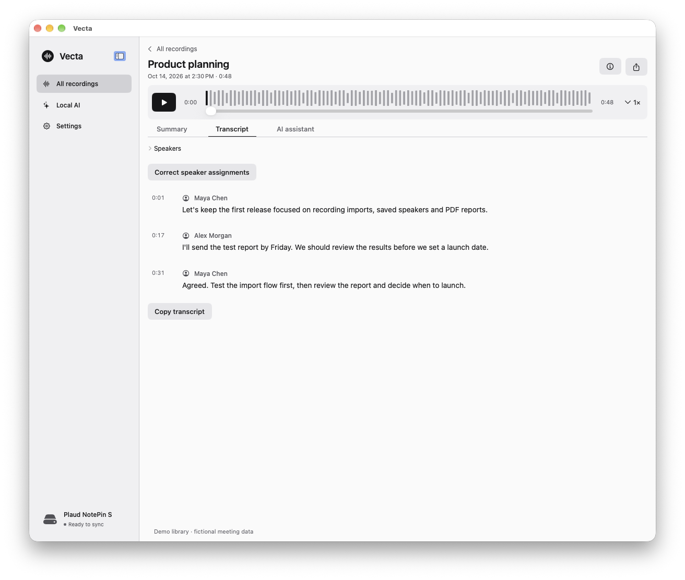
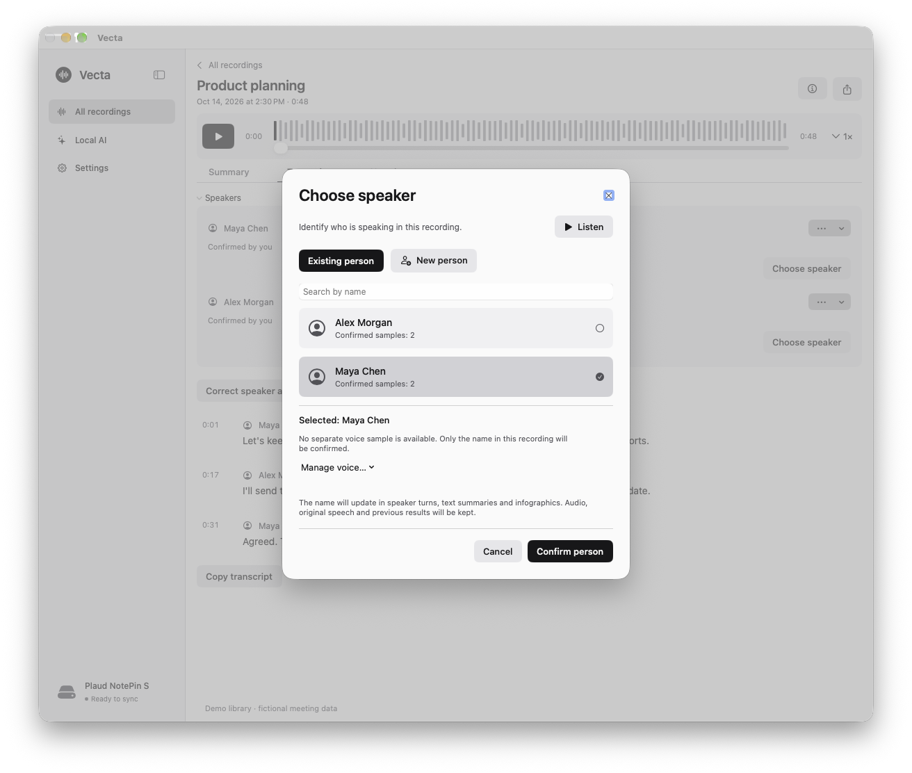
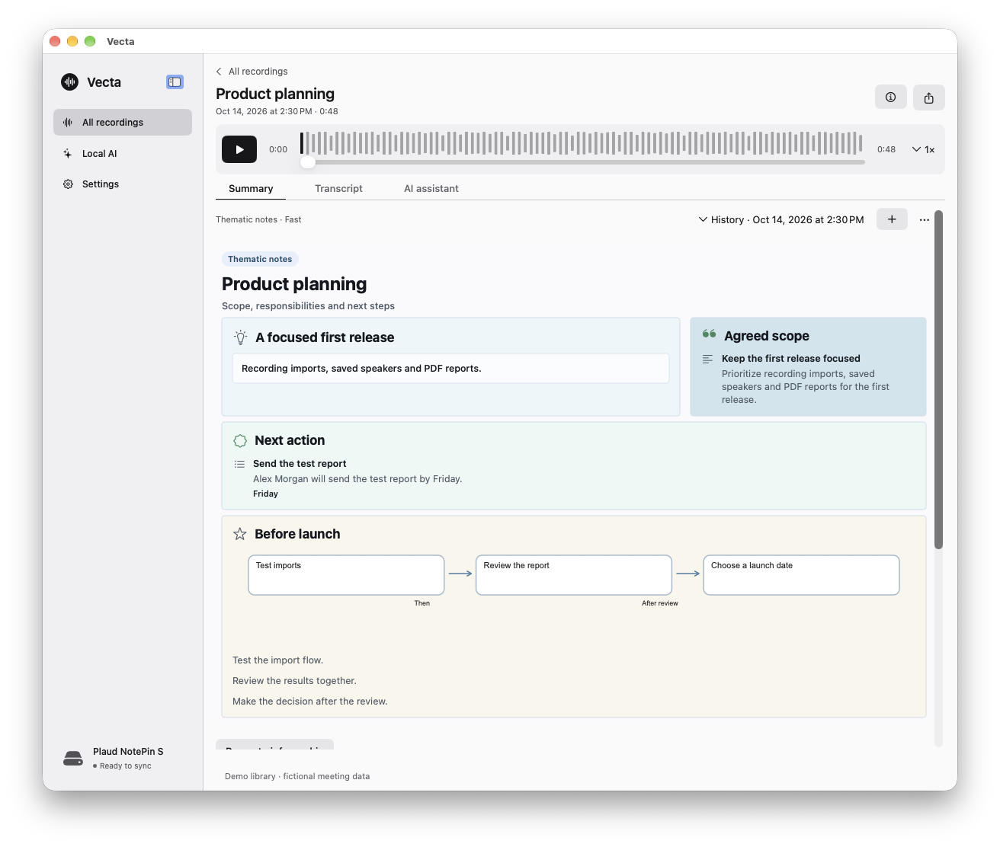
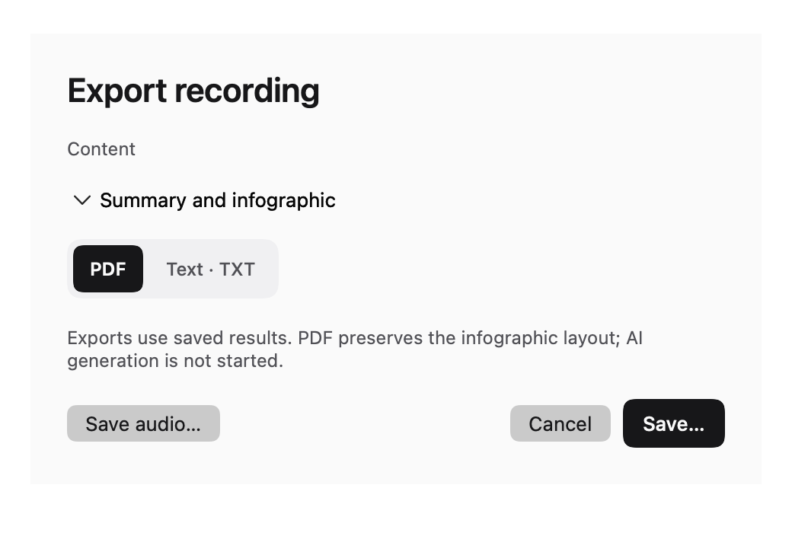
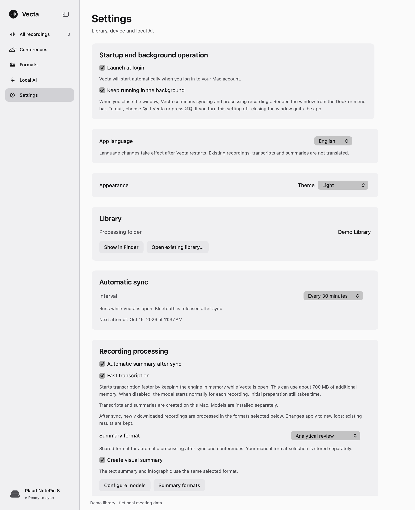
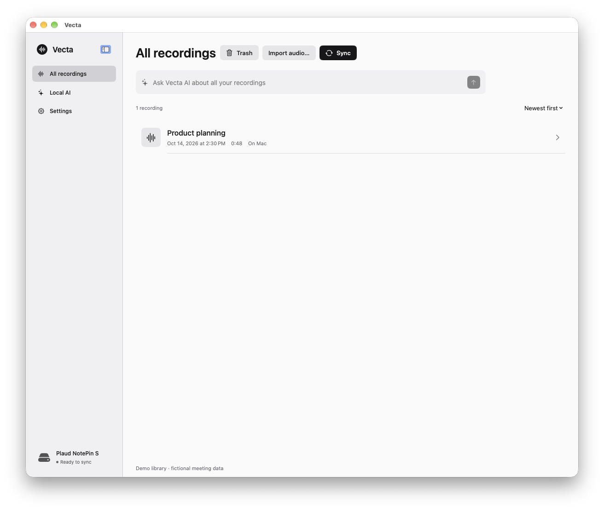

# Vecta

**PLAUD recordings, processed locally on your Mac.**

Sync recordings directly over Bluetooth or Wi-Fi, transcribe and summarize them
on-device, save speaker profiles, and export PDF reports. Vecta is a native macOS
app for Apple Silicon Macs with **8 GB of unified memory or more** using the 4B
model. The interface supports **English and Russian**.

[Download the developer preview](https://github.com/olgvroe/Vecta/releases/tag/v0.1.0)
· [Build from source](docs/BUILD.md)
· [Installation](docs/INSTALL.md)



*Screenshots show the real native interface with fictional meeting data. The demo
transcript and summaries are prepared examples, not model-quality benchmarks.*

## A local workflow

Vecta implements its own **BLE and local Wi-Fi Fast Transfer**, without the PLAUD
SDK, a relay website, or an intermediary service for recording transfer. Audio is
received directly from the selected recorder and kept in your local library.

Speech recognition, speaker separation, text and visual summaries, and the
assistant run on your Mac. **No recording content is sent to cloud inference, and
there is no cloud fallback.** You do not need Docker, a browser dashboard or a
separate model server.

Internet access is needed for initial device authorization and model downloads.
Once your recorder is configured and the models are installed, normal recording
transfer and processing work without Internet access. Installing another model
or deliberately refreshing authorization may require it again.

> **Device setup:** first-time connection to a modern PLAUD recorder requires your
> own authorized PLAUD Partner credentials. Vecta does not include shared keys or
> provide Partner access. You can import local audio without device credentials.
> See [setup and network boundaries](#setup-and-network-boundaries).

## Remember who is speaking

Save named voice profiles and use them in later recordings. Confirm a suggested
speaker, correct a name, or merge speaker groups while preserving saved results.
Voice samples and profiles remain local.



## Visual summaries

Read the main points as a visual report: decisions, responsibilities, next steps,
quotes and relationships. Text summaries and the visual report stay with the
recording, alongside the original transcript and processing history.



## PDF reports

Export a transcript, text summary, visual summary or complete report as **PDF or
TXT**. PDF export preserves the visual layout and uses saved results; exporting
does not start another AI job.



[Open the fictional meeting's sample PDF](docs/assets/sample-report.pdf).

## Automatic sync and processing

Choose a sync interval and enable automatic summaries. While Vecta is open and
the recorder is available, new recordings can be downloaded, transcribed and
summarized locally without starting each job by hand. You choose the summary
formats and can pause or cancel processing.

Automatic sync runs **while the app is open**; Vecta is not a background service
that continues after you quit it.



## Your recording library

Keep recordings, transcripts and different summary versions together. Search the
library, listen to the original audio, ask the assistant about a recording, or
ask questions across saved transcripts.

<details>
<summary>Library screenshot</summary>




</details>

## Requirements

- **Apple Silicon Mac, macOS 15 or later.** Intel and iOS/iPadOS are not supported.
- **8 GB unified memory for Qwen 4B; 16 GB for Qwen 9B.** Available memory and
  recording length still matter. The minimum is not a guarantee for every workload.
- Several GB of free disk space for models, recordings and processing files.
- Models are installed separately through an explicit user action.

Speech uses WhisperKit large-v3 Turbo and SpeakerKit. Summaries and assistant
features use MLX Qwen3.5 4B/9B. The interface is available in English and Russian;
new processing jobs retain their selected language policy.

## Install

Download the DMG from [Releases](https://github.com/olgvroe/Vecta/releases), open it,
and drag Vecta to Applications. Back up an existing library before replacement or
migration.

**0.1.0 is a developer preview, ad-hoc signed and not notarized.** Gatekeeper may
block it. Verify the release origin and checksums; if you choose to trust it, use
Apple's documented **Privacy & Security → Open Anyway** route. Do not disable
Gatekeeper or bypass a malware warning. See [installation instructions](docs/INSTALL.md).

A clean-user, downloaded-DMG first-launch test is not claimed for this preview.
[Verification status and limits](RELEASE_READINESS_REPORT.md) distinguish local,
GitHub CI, physical-device and clean-user checks.

## Device support

- **PLAUD NotePin S:** direct BLE and Fast Transfer accepted on an existing owner
  recorder/Mac setup, including MP3 import and previous-network restoration.
- **PLAUD Note, NotePin and Note Pro:** adapters are present; compatibility with
  every device and firmware is not claimed.
- **Local audio:** import recordings without a PLAUD account.

Vecta is independent software, not an official PLAUD product.

## Setup and network boundaries

Initial Partner provisioning sends authorization and device metadata to PLAUD
Partner endpoints. It does **not** upload recording audio, transcripts, summaries,
voice embeddings or documents. Credentials and cached device identities are kept
in the login Keychain; valid cached reconnection is local.

Model installation downloads pinned revisions from Hugging Face and verifies
file sizes and SHA-256. Inference workers are launched with a deny-network policy.
Fast Transfer uses the recorder's local Wi-Fi network and restores the previous
network afterward. It does not route audio through an Internet service.

The main app is not advertised as App-Sandbox-entitled. It uses macOS permissions,
filesystem access and bookmarks; local inference workers have a separate
network-denying sandbox policy. Read the [security policy](SECURITY.md) before
reporting a vulnerability. Never attach private recordings or credentials to a
public issue.

## Build and contribute

Install full Xcode 26.4+ with Swift 6.3+/Metal tools, Python 3.9+, Git, make and
curl. From the source root, using a new output directory:

```sh
python3 -I Tools/release.py build dist/Vecta-0.1.0 --version 0.1.0 --build 65
```

The command builds and checks the native app, workers, codecs, relink kit and DMG.
It does not install an app, download model weights, operate a recorder or publish
anything. No CMake, llama.cpp, PLAUD SDK or hosted backend is required.

See [BUILD](docs/BUILD.md), [CONTRIBUTING](CONTRIBUTING.md), [CHANGELOG](CHANGELOG.md)
and [source provenance](docs/PROVENANCE.md). Main branch: `main`; development:
`develop`. Preserve user data, historical schemas and third-party notices.

## License and origin

Vecta is licensed under [Apache-2.0](LICENSE). It retains adaptations from the
Apache-2.0 PinPoint baseline, with [NOTICE](NOTICE), provenance and import/rename
ledgers. It makes no clean-room claim.

Dependencies and model weights have separate licenses. Each distributed DMG
is accompanied by matching source, component notices and a working **LAME source/object/
relink kit**. See [dependency obligations](docs/DEPENDENCIES.md).
